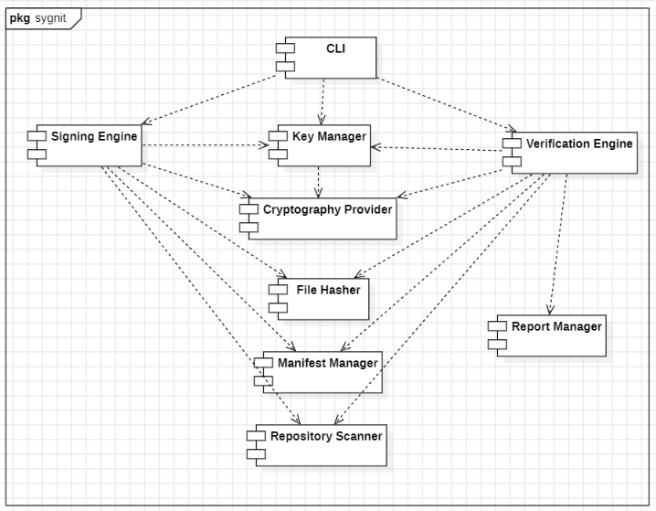

# Introduction

# System Overview

# High-Level Architecture

# Component Responsibilities
|No.	|Component	|Responsibility|
|--|--|--|
|1|	CLI	|Accepts commands and arguments.|
|2|	Signing Engine	|Coordinates file and repository signing.|
|3|	Verification Engine	|Coordinates signature and integrity verification.|
|4|	Key Manager	|Generates, loads and stores keys.|
|5|	Repository Scanner	|Identifies files in the repository.|
|6|	File Hasher	|Calculates SHA-256 hashes.|
|7|	Manifest Manager	|Creates, reads and serializes manifests.|
|8|	Cryptography Provider	|Performs Ed25519 signing and verification.|
|9|	Report Manager	|Produces verification results and error reports.|

# Class Design

# Signing Workflow

# Verification Workflow

# Activity Flows

# Data Flow

# Technology and Cryptographic Decisions

# Security Considerations

# Future Extensibility